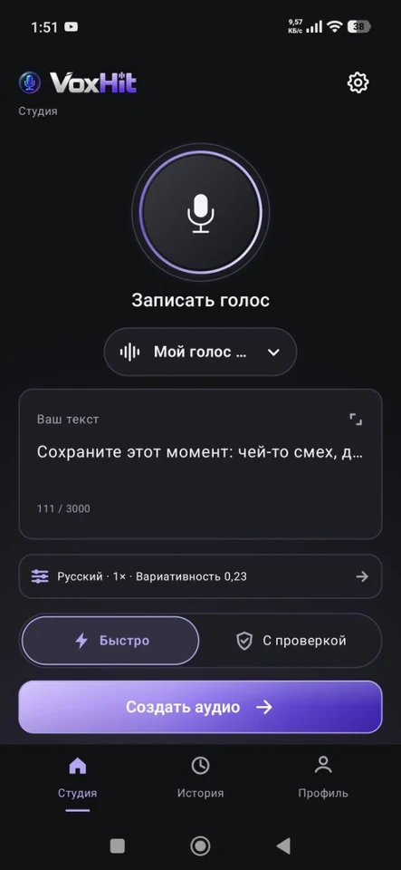
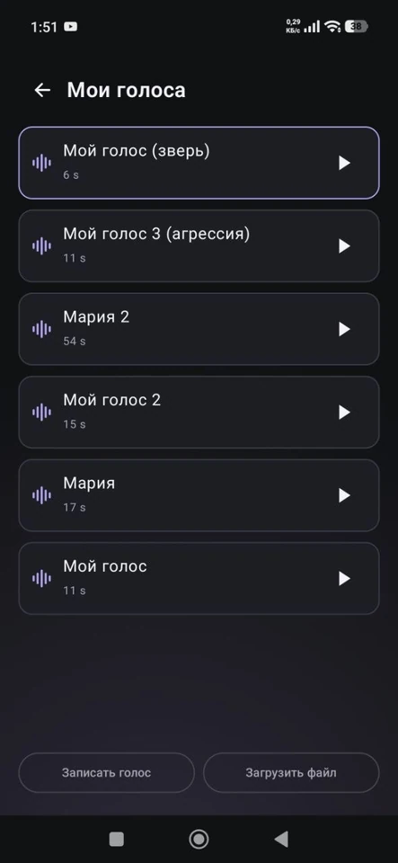

# VoxHit - мобильная студия озвучки с ИИ

**Автор проекта:** [Евгений Толмачев](https://github.com/EvgenyET) · [Страница проекта в портфолио](https://evgeny-dev.pro/project.html?id=VoxHit)

Android-приложение для озвучки текста и клонирования голоса по образцу. Запись с микрофона, выбор языка, библиотека аудио и экспорт MP3/WAV. Генерация выполняется отдельным серверным модулем.

## Мой вклад

Разработал мобильный клиент для записи образца голоса, подготовки текста и прослушивания озвучки. Связал Android-интерфейс с серверной очередью синтеза и библиотекой результатов. Генерацию выполняет речевая модель на сервере.

## Интерфейс

| Запись образца голоса в Android-приложении | Библиотека голосов |
|:---:|:---:|
|  |  |

## Как это работает

VoxHit - нативное Android-приложение на Kotlin и Jetpack Compose. Пользователь записывает или импортирует образец голоса, вводит текст, выбирает язык и параметры озвучки. Приложение отправляет задание в API, показывает этапы обработки и сохраняет результат в личной библиотеке. Синтез речи выполняется вне телефона. Сервер FastAPI управляет очередью PostgreSQL, а отдельный обработчик запускает Qwen3-TTS на локальном компьютере или в RunPod. Готовое аудио можно прослушать, скачать в MP3/WAV и отправить через системное меню Android.

## Возможности

- Запись голоса через микрофон или импорт аудиофайла, прослушивание образца и сохранение в личной библиотеке голосов.
- Редактор сохраняет черновики длиной до 3000 символов и позволяет выбрать язык, темп и вариативность речи.
- Быстрый синтез или режим с распознаванием результата и проверкой соответствия исходному тексту.
- Отображение очереди и этапов обработки. Восстановление просмотра активного задания после повторного открытия приложения.
- Готовые записи можно перематывать, экспортировать в MP3 или WAV и отправлять другим пользователям. Текст можно открыть для повторного редактирования.
- Вход по email или Google, светлая и тёмная темы, десять языков интерфейса.

## Технологии

- **Kotlin / Jetpack Compose / Material 3** - Нативные экраны Android, темы, адаптация интерфейса и локализация.
- **Coroutines / StateFlow / Retrofit / OkHttp** - Состояние экранов, асинхронная работа с API и отслеживание заданий.
- **MediaRecorder / MediaPlayer / FileProvider** - Запись микрофона, прослушивание и передача аудиофайлов другим приложениям.
- **Python / FastAPI / PostgreSQL** - API, пользователи, библиотека голосов, очередь и состояние обработки.
- **SQLAlchemy / Alembic** - Модели данных, транзакции и миграции базы.
- **Qwen3-TTS / PyTorch / faster-whisper** - Синтез речи по образцу голоса, расшифровка и проверка текста.
- **FFmpeg / Silero VAD** - Обработка аудио, изменение темпа, экспорт и определение окончания речи.
- **Docker / RunPod / PySide6** - Изолированные обработчики, облачное выполнение и настольная панель администрирования.

## О проекте

Клиент-серверный проект с разделением мобильного интерфейса, API и ресурсоёмкой генерации. Android-клиент отвечает за запись, редактор и воспроизведение. Сервер хранит состояние заданий и проверяет доступ к файлам. Для управления очередью, режимом обработки и статистикой разработано отдельное приложение VoxHit Admin на PySide6.

Коммерческий проект. Исходный код закрыт.
